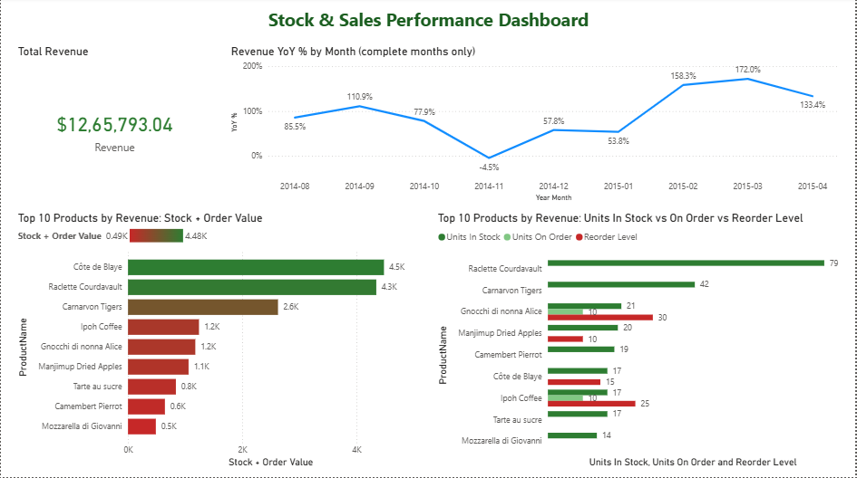
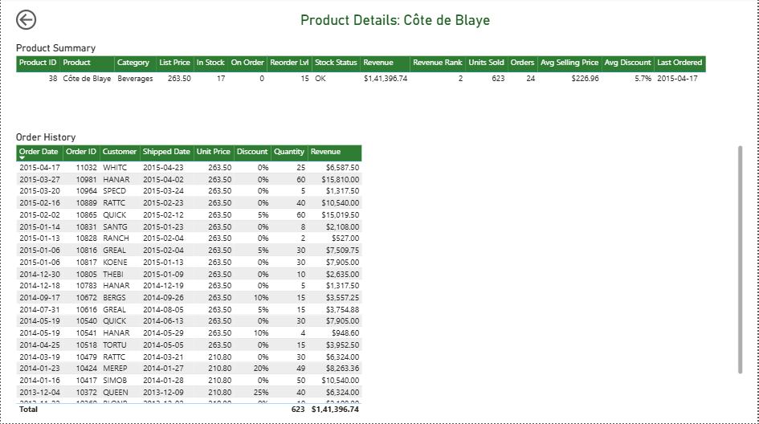
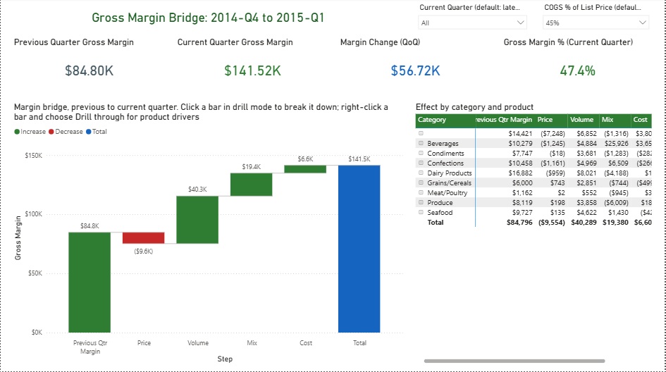
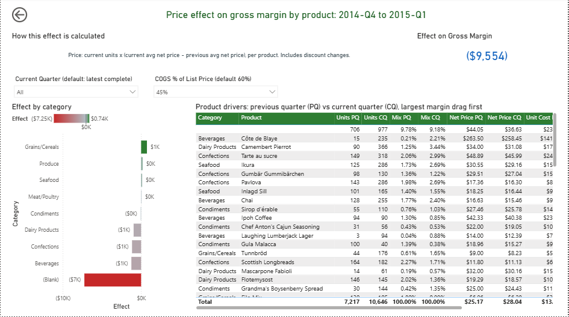

# Powerbi
Agentic Power BI reports 

**Stock deviation report:** a Power BI project (`stock_deviation.pbip`) built on Northwind sales data (`orders.csv`, `order_details.csv`) and the Northwind product catalogue. It tracks stock levels, sales performance and quarter-over-quarter gross margin.

## Report pages

### 1. Stock & Sales Overview

The landing page. It shows total revenue and the month-by-month revenue change versus the same month a year earlier (complete months only). The two bar charts cover the top 10 products by revenue: the value of their stock plus open orders, and their units in stock and on order against the reorder level. Right-click a product and choose **Drill through → Details** to see that product's history.

### 2. Product Details (drillthrough)

One product at a time:
- **Summary row:** list price, stock status, revenue and revenue rank, units sold, average selling price, average discount, and last order date.
- **Order history:** every order line for the product, newest first.

Use the back arrow to return to the overview.

### 3. Margin Bridge

Explains how gross margin changed from the previous quarter to the current one.
- **Waterfall chart:** starts at last quarter's margin, adds the **Price**, **Volume**, **Mix** and **Cost** effects, and ends at this quarter's margin. In drill mode, click a bar to break it down by category, then by product.
- **Matrix:** every effect by category, expandable to product.
- **Quarters compared:** by default the latest complete quarter against the one before it. Use the quarter slicer to pick another.

Because the source data has no product cost, cost is modelled:
- **Standard cost:** list price × a COGS % that you can change with the slicer (default 60%).
- **Freight:** each order's freight is split across its lines by line value.

### 4. Margin Bridge Details (drillthrough)

Right-click a waterfall bar and choose **Drill through → Margin Bridge Details** to see what drove that effect. The page shows:
- How the effect is calculated, and its total.
- The effect by category.
- A product table with units, mix share, net price, unit cost and unit margin for both quarters. The products that hurt margin most are listed first.

The screenshot shows the Price effect for 2014-Q4 → 2015-Q1.

> All screenshots were taken with the COGS % slicer set to 45%, so their margin figures differ from the 60% default.

### How the margin effects are calculated
Each effect is calculated per product, so the four effects add up exactly to the margin change at product, category and total level.

| Effect | Formula (per product) |
|---|---|
| Price | current units × (current avg net price − previous avg net price) |
| Volume | previous margin × (total units growth %) |
| Mix | current units × previous unit margin − previous margin × (1 + total units growth %) |
| Cost | current units × (previous unit cost − current unit cost) |

A product sold in only one of the two quarters counts entirely towards **Mix**.
